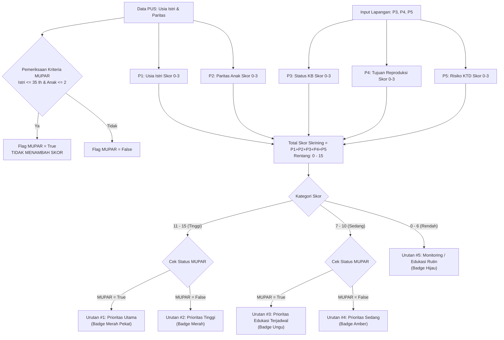
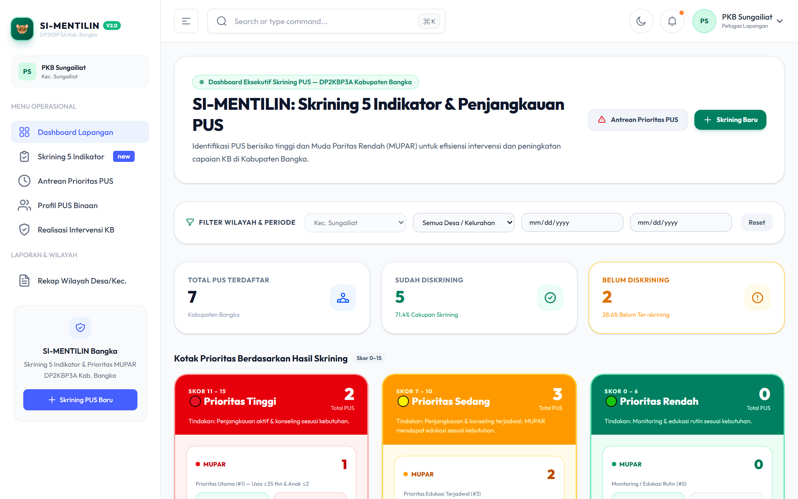
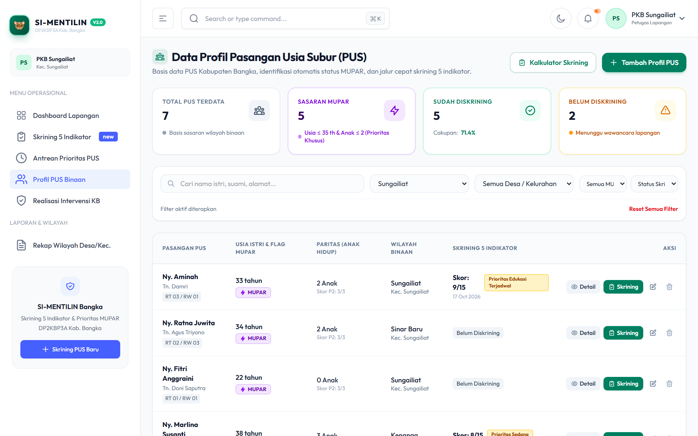
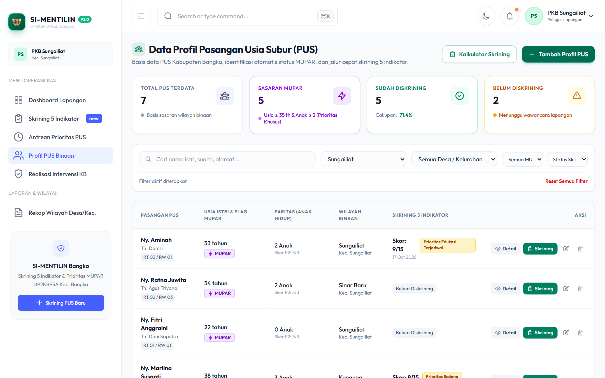
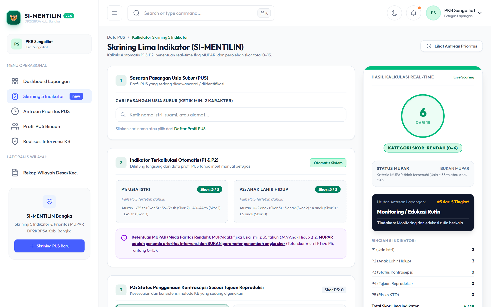
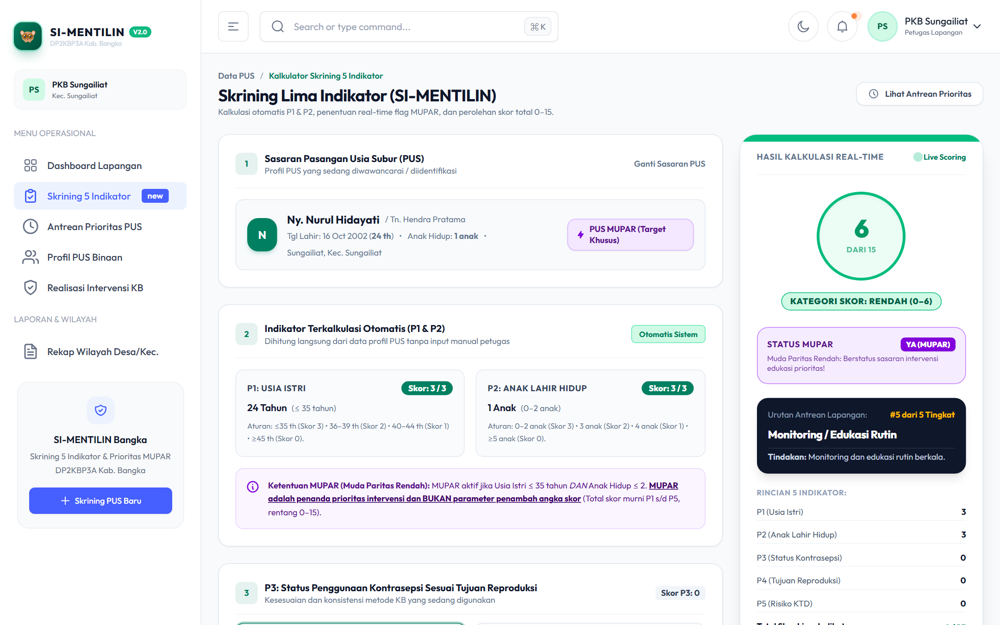
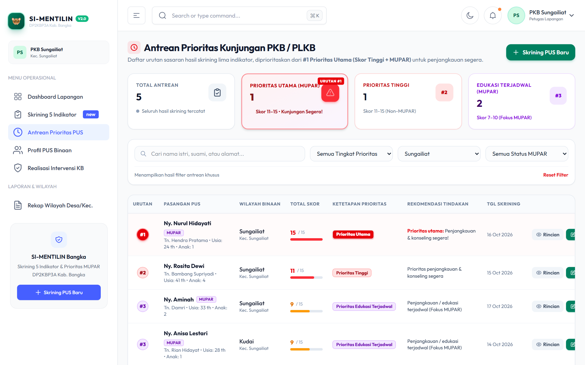
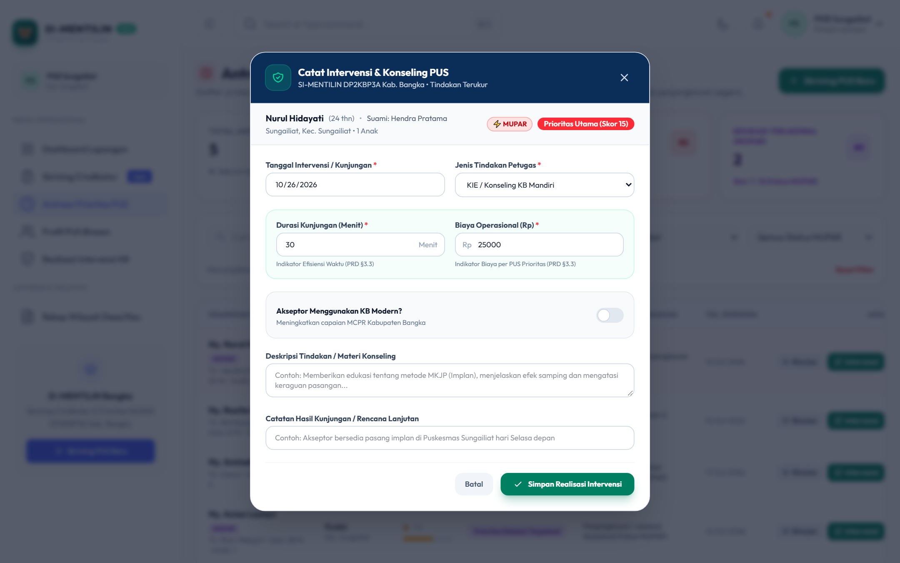
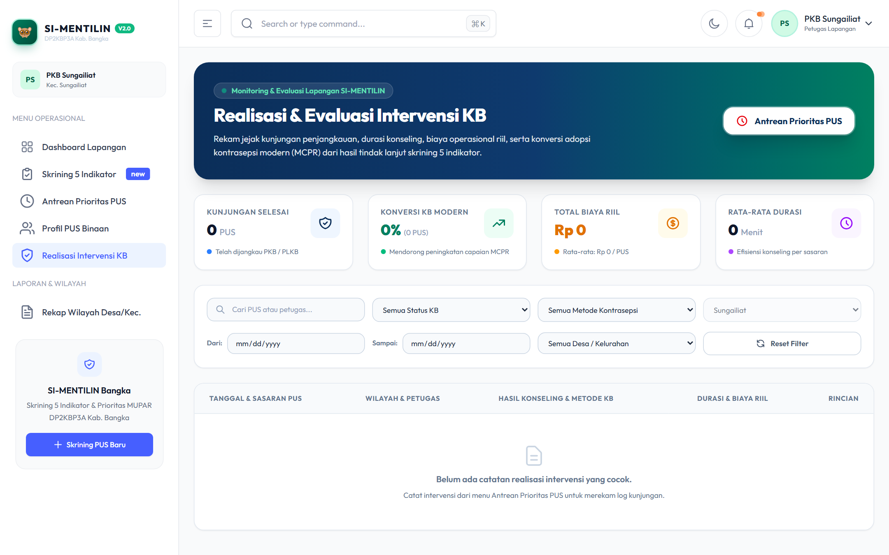
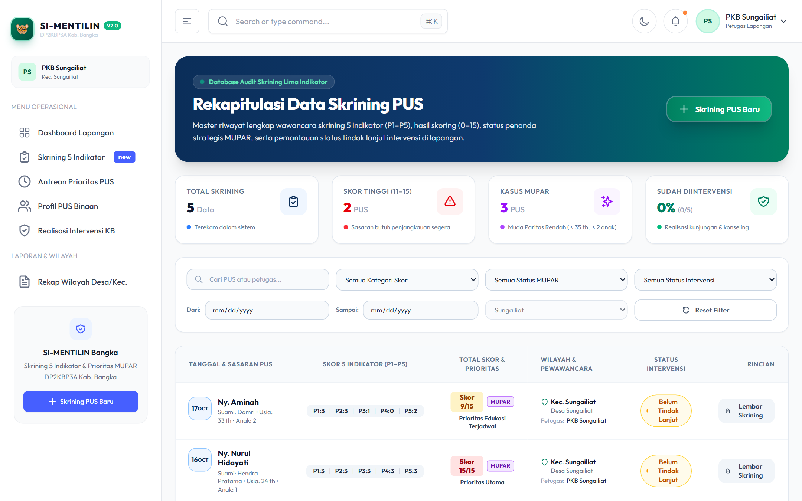

# Panduan Penggunaan Aplikasi SI-MENTILIN
### Sistem Skrining Lima Indikator PUS & Penanda Sasaran MUPAR
**Dinas Pengendalian Penduduk, Keluarga Berencana, Pemberdayaan Perempuan dan Perlindungan Anak (DP2KBP3A) Kabupaten Bangka**

---

## 📌 Pengantar Sistem

**SI-MENTILIN** adalah platform sistem informasi terintegrasi yang dikembangkan untuk mempercepat penapisan risiko kehamilan pada Pasangan Usia Subur (PUS), mengidentifikasi sasaran strategis **Muda Paritas Rendah (MUPAR)**, serta mengelola antrean intervensi terpadu bagi Petugas Lini Lapangan KB di seluruh wilayah Kabupaten Bangka.

Dokumentasi ini menyediakan panduan operasional lengkap yang dilengkapi **tangkapan layar aplikasi (*screenshots*)** asli untuk dua peran pengguna utama sistem, tersedia dalam format **Markdown** maupun **Microsoft Word (.docx)** siap cetak:

| Buku Panduan | Sasaran Pengguna | Format Markdown | Format Microsoft Word (.docx) |
| :--- | :--- | :---: | :---: |
| **Buku Panduan Petugas Lapangan (PKB/PLKB)** | PKB, PLKB, Pembina Wilayah, Koordinator Kecamatan | [📖 Buka Markdown](docs/panduan/PANDUAN_PKB.md) | [📄 Unduh Word (.docx)](docs/panduan/Panduan_Penggunaan_SI-MENTILIN_PKB.docx) |
| **Buku Panduan Administrator Dinas** | Super Admin, Pengelola Program DP2KBP3A Bangka | [📖 Buka Markdown](docs/panduan/PANDUAN_ADMIN.md) | [📄 Unduh Word (.docx)](docs/panduan/Panduan_Penggunaan_SI-MENTILIN_Admin.docx) |
| **Buku Panduan Lengkap SI-MENTILIN** | Seluruh Stakeholder & Pengambil Kebijakan | [📖 Buka Markdown](PANDUAN_PENGGUNAAN.md) | [📄 Unduh Word (.docx)](Panduan_Penggunaan_Aplikasi_SI-MENTILIN.docx) |

---

## 🔑 Kredensial Akun Default (Demo & Pelatihan)

Untuk kebutuhan simulasi, orientasi petugas, dan pengujian sistem, akun default yang tersedia di basis data adalah:

| Peran Sistem | Alamat Email Resmi | Kata Sandi | Wilayah Penugasan |
| :--- | :--- | :--- | :--- |
| **Admin Dinas** | `admin@simentilin.bangka.go.id` | `password` | Seluruh Kabupaten Bangka (8 Kecamatan) |
| **Petugas Lapangan** | `pkb.sungailiat@simentilin.bangka.go.id` | `password` | Kecamatan Sungailiat & Kelurahan Kudai/Sungailiat |

---

## 🧠 Aturan Mutlak Logika Bisnis (Domain Constraints)

Setiap pengguna dan pengembang aplikasi wajib memahami 3 prinsip inti kalkulasi SI-MENTILIN:

### 1. Skoring 5 Indikator (0–15):
- Hanya 5 parameter yang dijumlahkan secara aritmatika: `P1` (Usia Istri), `P2` (Jumlah Anak Lahir Hidup), `P3` (Status Kontrasepsi), `P4` (Tujuan Reproduksi), dan `P5` (Risiko KTD).
- Masing-masing bernilai `0`, `1`, `2`, atau `3`.
- Total skor minimum adalah `0` dan maksimum adalah `15`.

### 2. Posisi Strategis MUPAR (DILARANG MENAMBAH SKOR):
- **MUPAR (Muda Paritas Rendah) BUKAN parameter keenam.** Bobot angka MUPAR tidak pernah ditambahkan ke dalam `total_skor`.
- MUPAR adalah penanda khusus (*boolean flag*) yang mengkombinasikan kategori skor untuk menentukan urgensi penanganan lapangan:
  - **Skor 11–15 + MUPAR** $\rightarrow$ **Prioritas Utama (#1)**
  - **Skor 11–15 + Non-MUPAR** $\rightarrow$ **Prioritas Tinggi (#2)**
  - **Skor 7–10 + MUPAR** $\rightarrow$ **Prioritas Edukasi Terjadwal (#3)**
  - **Skor 7–10 + Non-MUPAR** $\rightarrow$ **Prioritas Sedang (#4)**
  - **Skor 0–6 (MUPAR / Non-MUPAR)** $\rightarrow$ **Monitoring / Edukasi Rutin (#5)**

### 3. Matriks Pembagian Peran Pengguna:

| Fitur / Modul | Petugas Lapangan (PKB/PLKB) | Admin Dinas DP2KBP3A |
| :--- | :---: | :---: |
| **Cakupan Wilayah Data** | Dibatasi per kecamatan/desa binaan | Seluruh Kabupaten Bangka (8 Kecamatan) |
| **Entri & Edit Data PUS** | Ya | Ya (Pengawasan & Konfirmasi) |
| **Kalkulator Skrining 5 Indikator** | Ya | Ya |
| **Antrean Prioritas & Intervensi** | Ya (Eksekusi Kunjungan Rumah) | Ya (Monitoring Kasus Berisiko) |
| **Laporan Wilayah** | Ya (Tingkat Desa/Kecamatan) | Ya (Rekapitulasi Tingkat Kabupaten) |
| **Manajemen Pengguna (Akun PKB)** | Tidak | Ya (Penuh) |
| **Master Wilayah (Kecamatan/Desa)** | Tidak | Ya (Penuh) |
| **Analitik MCPR, TFR & Nilai Ekonomis** | Ya (Tinjauan Wilayah) | Ya (Proyeksi Strategis Daerah) |

---

## 📸 Galeri Tangkapan Layar & Alur Kerja Aplikasi

Berikut adalah dokumentasi visual antarmuka aplikasi SI-MENTILIN:

### 1. Halaman Masuk Terpadu (Portal Login)
Antarmuka autentikasi yang aman dilengkapi pembatasan *rate limiting* dan pemilih visibilitas sandi.

---

### 2. Dashboard Petugas Lapangan (PKB)
Pusat kontrol kerja harian petugas lapangan untuk memantau capaian PUS, skrining selesai, dan sinyal darurat kasus prioritas utama.

---

### 3. Pengelolaan Basis Data PUS & Modal Input Baru
Basis data profil keluarga sasaran di wilayah binaan dilengkapi pencarian instan dan jendela modal penambahan PUS.

---

### 4. Formulir Skrining 5 Indikator & Deteksi Otomatis MUPAR
Formulir interaktif dengan kalkulasi instan sisi klien. Memilih sasaran PUS otomatis mendeteksi usia, jumlah anak, parameter P1-P2, badge MUPAR, serta kategori prioritas akhir.

---

### 5. Antrean Prioritas Penanganan & Modal Tindak Lanjut Intervensi
Sistem antrean cerdas yang menempatkan PUS MUPAR berisiko tinggi di urutan teratas (*Prioritas Utama #1*) dan tombol aksi cepat pencatatan intervensi lapangan.

---

### 6. Realisasi Pelayanan Intervensi KB & Riwayat Skrining
Rekam jejak komprehensif seluruh advokasi, konseling KIE, fasilitasi pemasangan kontrasepsi modern, dan jejak audit skrining berkala.

---

### 7. Dashboard Makro Administrator Dinas
Monitoring terpadu situasi keluarga berencana di 8 kecamatan se-Kabupaten Bangka bagi pengambil kebijakan di dinas.

---

### 8. Manajemen Akun Pengguna & Master Wilayah
Modul admin untuk membuat akun PKB, mengatur penugasan wilayah kerja kecamatan/desa, reset sandi, serta pemeliharaan master wilayah.

---

### 9. Rekapitulasi Laporan Dinas & Modul Analitik Dampak Kebijakan
Penarikan laporan rekapitulasi ber-kop resmi dinas, visualisasi tren capaian MCPR, proyeksi penurunan TFR, serta kalkulasi nilai ekonomis penghematan anggaran kesehatan daerah.

---

## 📖 Tautan Cepat Berkas Panduan Lengkap

### Format Microsoft Word (.docx) Siap Cetak:
- 📄 [**Unduh Panduan PKB (.docx)**](docs/panduan/Panduan_Penggunaan_SI-MENTILIN_PKB.docx) *(4.5 MB - Lengkap dengan Gambar)*
- 📄 [**Unduh Panduan Admin Dinas (.docx)**](docs/panduan/Panduan_Penggunaan_SI-MENTILIN_Admin.docx) *(3.5 MB - Lengkap dengan Gambar)*
- 📄 [**Unduh Buku Panduan Lengkap SI-MENTILIN (.docx)**](Panduan_Penggunaan_Aplikasi_SI-MENTILIN.docx) *(6.5 MB - Master Lengkap)*

### Format Markdown:
- 📘 [**Buku Panduan Petugas Lapangan (PKB/PLKB)**](docs/panduan/PANDUAN_PKB.md)
- 📙 [**Buku Panduan Administrator Dinas DP2KBP3A**](docs/panduan/PANDUAN_ADMIN.md)
- 📁 [**Direktori Tangkapan Layar Lengkap (19 Berkas Gambar HD)**](docs/panduan/images/)

---
*© 2026 DP2KBP3A Kabupaten Bangka. SI-MENTILIN dikembangkan untuk akselerasi penapisan KB dan perlindungan keluarga berkualitas di Kabupaten Bangka.*
