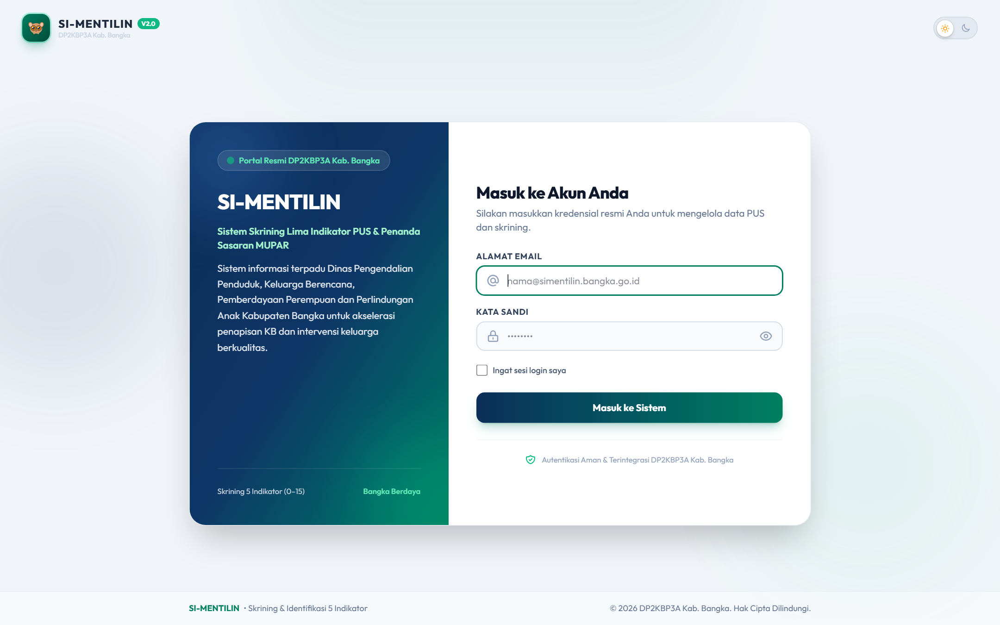
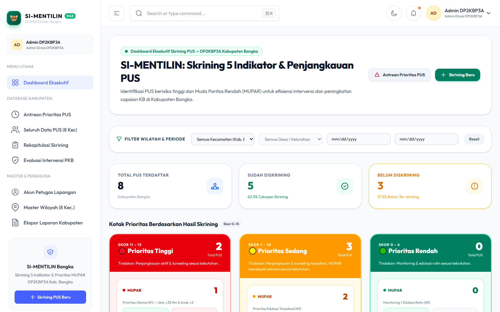
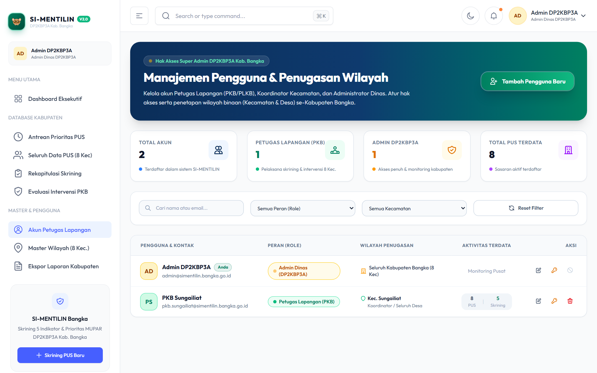
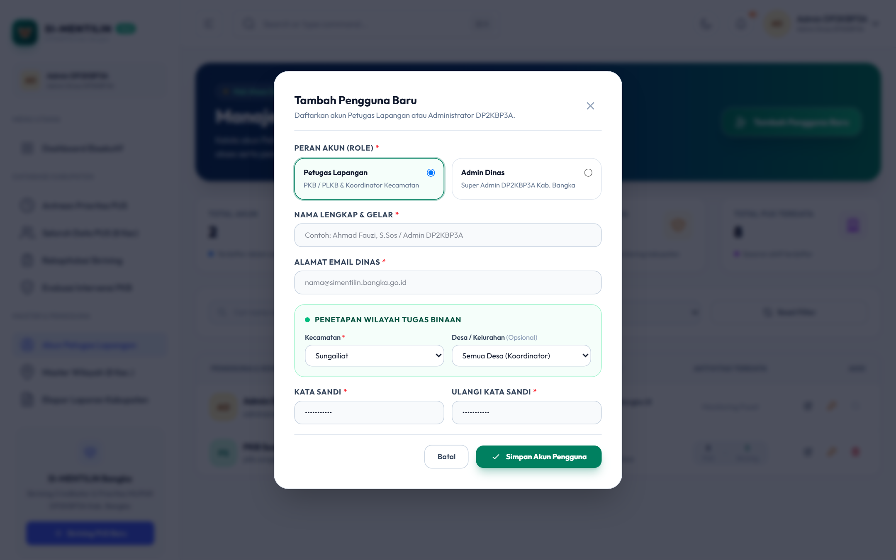
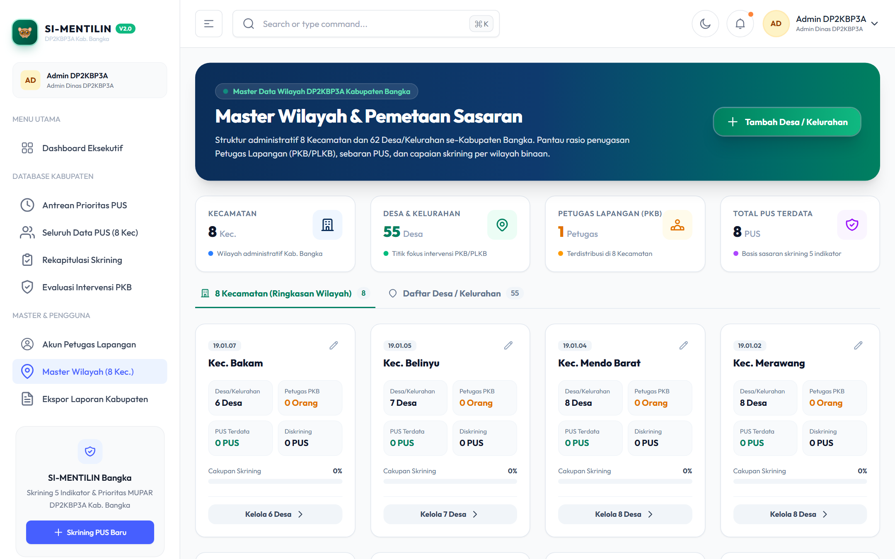
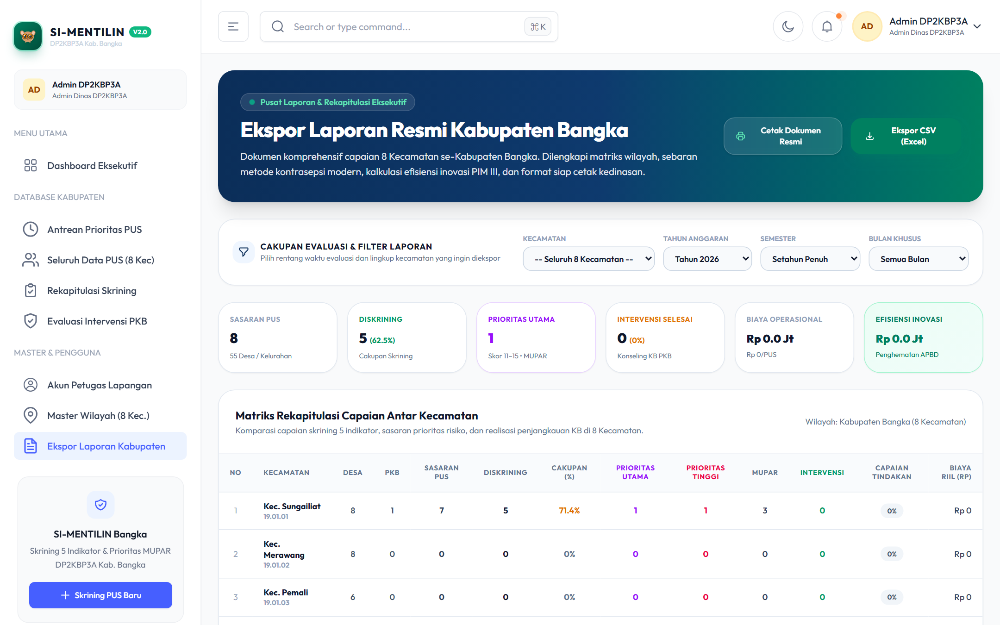
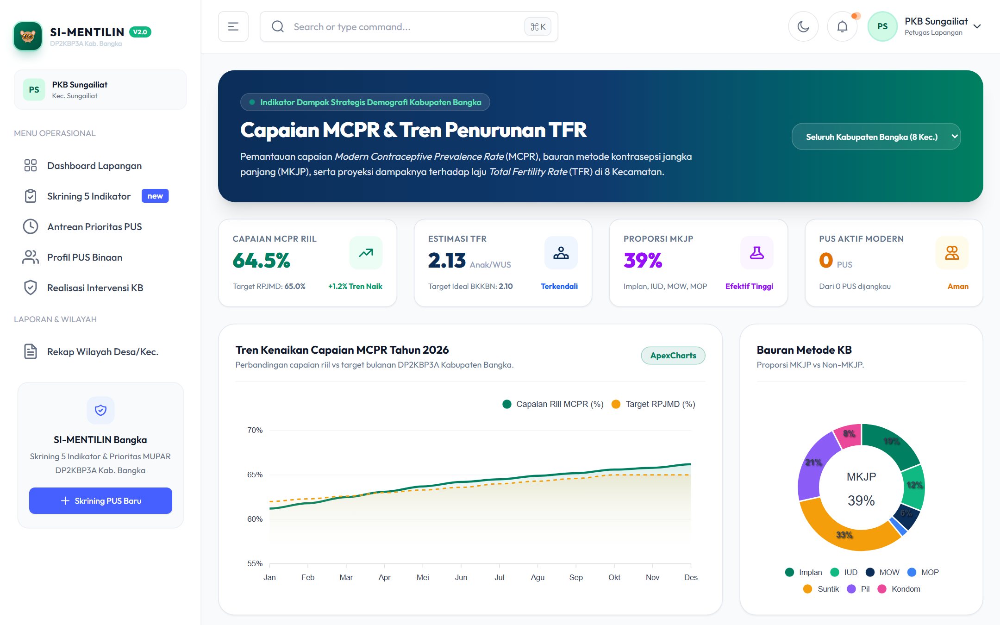

# Panduan Penggunaan SI-MENTILIN untuk Administrator Dinas

Selamat datang di Buku Petunjuk Operasional **SI-MENTILIN** (*Sistem Skrining Lima Indikator PUS & Penanda Sasaran MUPAR*) untuk **Administrator Dinas / Pengelola Program KB** pada **Dinas Pengendalian Penduduk, Keluarga Berencana, Pemberdayaan Perempuan dan Perlindungan Anak (DP2KBP3A) Kabupaten Bangka**.

Buku panduan ini disusun sebagai acuan kerja resmi pengelola sistem tingkat kabupaten dalam mengelola akun pengguna, master wilayah kecamatan/desa, monitoring kinerja penapisan lapangan, validasi agregat pelaporan, serta perumusan kebijakan berbasis modul analitik.

> 📄 **Format Microsoft Word (.docx):** Dokumen ini juga tersedia dalam versi siap cetak bertata letak resmi: [**Unduh Panduan_Penggunaan_SI-MENTILIN_Admin.docx**](Panduan_Penggunaan_SI-MENTILIN_Admin.docx)

---

## Daftar Isi
1. [Peran & Wewenang Administrator Dinas](#1-peran--wewenang-administrator-dinas)
2. [Akses Masuk & Autentikasi Super Admin](#2-akses-masuk--autentikasi-super-admin)
3. [Dashboard Monitoring Makro Kabupaten Bangka](#3-dashboard-monitoring-makro-kabupaten-bangka)
4. [Manajemen Pengguna Sistem (User Management)](#4-manajemen-pengguna-sistem-user-management)
   - [Melihat Daftar Pengguna](#melihat-daftar-pengguna)
   - [Membuat Akun Petugas Lapangan Baru](#membuat-akun-petugas-lapangan-baru)
   - [Reset Kata Sandi & Pengelolaan Akun](#reset-kata-sandi--pengelolaan-akun)
5. [Pengelolaan Master Wilayah (Kecamatan & Kelurahan/Desa)](#5-pengelolaan-master-wilayah-kecamatan--kelurahandesa)
6. [Modul Rekapitulasi Laporan Tingkat Kabupaten](#6-modul-rekapitulasi-laporan-tingkat-kabupaten)
   - [Pemfilteran Laporan Wilayah](#pemfilteran-laporan-wilayah)
   - [Ekspor Rekapitulasi (PDF & Excel)](#ekspor-rekapitulasi-pdf--excel)
7. [Modul Analitik & Pengambilan Kebijakan Strategis](#7-modul-analitik--pengambilan-kebijakan-strategis)
   - [Evaluasi Agregat 5 Indikator & MUPAR](#evaluasi-agregat-5-indikator--mupar)
   - [Simulasi Capaian MCPR & Proyeksi TFR](#simulasi-capaian-mcpr--proyeksi-tfr)
   - [Kalkulasi Nilai Ekonomis Penyelamatan (Cost Savings)](#kalkulasi-nilai-ekonomis-penyelamatan-cost-savings)
8. [Pemeliharaan Sistem, Keamanan & Tata Kelola Data](#8-pemeliharaan-sistem-keamanan--tata-kelola-data)
9. [Troubleshooting & Tanya Jawab (FAQ)](#9-troubleshooting--tanya-jawab-faq)

---

## 1. Peran & Wewenang Administrator Dinas

Dalam arsitektur 2-Role SI-MENTILIN, akun bertipe **`admin_dinas`** memiliki otoritas tertinggi:
1. **Akses Data Tanpa Batas Wilayah:** Admin Dinas berhak melihat, menganalisis, dan mengekspor data seluruh PUS di 8 kecamatan dan seluruh kelurahan/desa se-Kabupaten Bangka.
2. **Manajemen Akun Terpusat:** Berwenang membuat, menugaskan wilayah, mengatur ulang sandi, dan menonaktifkan akun petugas lapangan (PKB/PLKB).
3. **Integritas Master Wilayah:** Mengelola data referensi kode dan nama kecamatan serta desa/kelurahan di Kabupaten Bangka.
4. **Analitik Kebijakan Makro:** Mengakses simulasi MCPR, TFR, serta perhitungan nilai ekonomis belanja daerah yang berhasil diselamatkan dari pencegahan kehamilan risiko tinggi dan stunting.

---

## 2. Akses Masuk & Autentikasi Super Admin

Akses portal login melalui peramban web pada tautan resmi SI-MENTILIN.

### Prosedur Masuk:
1. Masukkan **Alamat Email** resmi Administrator Dinas (contoh: `admin@simentilin.bangka.go.id`).
2. Masukkan **Kata Sandi** administrator.
3. Klik tombol **Masuk ke Sistem**.
4. Sistem akan memvalidasi role akun dan langsung membuka menu khusus dinas pada bilah navigasi kiri.

> **Peringatan Keamanan:** Akun Administrator memiliki hak istimewa (*elevated privileges*). Selalu lakukan **Keluar (Logout)** setelah selesai menggunakan aplikasi, terutama jika mengakses melalui perangkat bersama.

---

## 3. Dashboard Monitoring Makro Kabupaten Bangka

Dashboard Admin menyajikan gambaran komprehensif situasi keluarga berencana dan skrining risiko kehamilan di seluruh Kabupaten Bangka.

### Informasi Utama pada Dashboard Admin:
1. **Total Akumulasi Kabupaten:**
   - Total PUS terdata di seluruh 8 kecamatan.
   - Total PUS yang telah selesai dilakukan penapisan 5 indikator.
   - Rasio sasaran PUS MUPAR (Muda Paritas Rendah) tingkat kabupaten.
   - Total intervensi pelayanan kontrasepsi modern yang telah terealisasi.
2. **Peringkat Antrean Prioritas Kabupaten:**
   - Jumlah kasus **Prioritas Utama (#1)** yang terdeteksi di setiap kecamatan, mempermudah dinas dalam mengalokasikan bantuan tim pelayanan bergerak (*mobile clinic*) atau dukungan logistik alokon.
3. **Peta / Grafik Komparasi Antar Kecamatan:**
   - Menampilkan perbandingan kinerja penapisan antar wilayah (Sungailiat, Belinyu, Merawang, Mendo Barat, Pemali, Bakam, Riau Silip, Puding Besar).

---

## 4. Manajemen Pengguna Sistem (User Management)

Menu **Manajemen Pengguna** (`/admin/users`) digunakan untuk mengelola seluruh akun pengguna sistem, khususnya para Penyuluh KB di lapangan.

### Melihat Daftar Pengguna

Akses menu **Kelola Pengguna** di bawah kelompok menu *Admin Dinas*.

Fitur yang tersedia:
- **Pencarian Cepat:** Mencari petugas berdasarkan nama, email, atau wilayah tugas.
- **Filter Berdasarkan Peran & Wilayah:** Menyaring khusus petugas lapangan pada kecamatan tertentu.
- **Status Penugasan:** Memantau keterkaitan akun PKB dengan kecamatan dan desa binaannya.

### Membuat Akun Petugas Lapangan Baru

Bila ada penambahan petugas PKB/PLKB baru atau mutasi penugasan:
1. Klik tombol **Tambah Pengguna Baru** di pojok kanan atas.
2. Jendela pop-up modal pendaftaran akan terbuka.

3. Isi formulir dengan data yang valid:
   - **Nama Lengkap:** Nama dan gelar petugas lapangan (contoh: *Budi Santoso, S.Sos*).
   - **Alamat Email:** Email dinas atau email operasional petugas.
   - **Kata Sandi Awal:** Buat kata sandi sementara (minimal 8 karakter).
   - **Konfirmasi Kata Sandi:** Ulangi kata sandi yang sama.
   - **Peran Sistem:** Pilih `Petugas Lapangan (PKB/PLKB)`.
   - **Penugasan Kecamatan:** Pilih kecamatan tempat petugas bertugas (contoh: *Sungailiat*).
   - **Penugasan Kelurahan/Desa:** Pilih desa spesifik atau kosongkan jika bertindak sebagai Koordinator Kecamatan (membawahi seluruh desa dalam 1 kecamatan).
4. Klik **Simpan Pengguna**. Akun langsung aktif dan dapat digunakan petugas untuk masuk ke sistem.

### Reset Kata Sandi & Pengelolaan Akun

Jika petugas lapangan lupa kata sandi atau kehilangan akses:
1. Cari nama petugas pada tabel daftar pengguna.
2. Klik tombol **Reset Sandi** (ikon kunci) pada kolom aksi.
3. Masukkan kata sandi baru dan konfirmasi kata sandi.
4. Klik **Perbarui Kata Sandi**. Berikan sandi baru tersebut secara aman kepada petugas yang bersangkutan.

---

## 5. Pengelolaan Master Wilayah (Kecamatan & Kelurahan/Desa)

Modul **Master Wilayah** (`/admin/wilayah`) menjamin konsistensi data spasial wilayah kerja Kabupaten Bangka.

### Fungsi Utama Modul Wilayah:
- **Daftar 8 Kecamatan Resmi Kabupaten Bangka:** Sungailiat, Belinyu, Merawang, Mendo Barat, Pemali, Bakam, Riau Silip, dan Puding Besar.
- **Hierarki Kelurahan / Desa:** Menampilkan daftar desa dan kelurahan yang terdaftar di bawah setiap kecamatan.
- **Validasi Data Lapangan:** Menghindari duplikasi penamaan desa atau ketidaksesuaian administrasi kewilayahan antara data BPS dan data DP2KBP3A.

---

## 6. Modul Rekapitulasi Laporan Tingkat Kabupaten

Menu **Rekapitulasi Laporan** (`/admin/laporan`) menyajikan data gabungan yang siap digunakan untuk pelaporan ke Bupati Bangka, BKKBN Perwakilan Provinsi Kepulauan Bangka Belitung, maupun kementerian terkait.

### Pemfilteran Laporan Wilayah
Admin Dinas dapat menarik laporan secara fleksibel berdasarkan:
1. **Wilayah Agregat:** Pilihan seluruh kabupaten, per satu kecamatan, atau per satu desa.
2. **Rentang Waktu:** Harian, bulanan, triwulanan, atau tahunan.
3. **Jenis Data:**
   - Rekapitulasi Profil PUS Terdata & Status MUPAR.
   - Capaian Skrining 5 Indikator per Kategori (Tinggi, Sedang, Rendah).
   - Realisasi Intervensi KB Modern (MKJP vs Non-MKJP).

### Ekspor Rekapitulasi (PDF & Excel)
- **Ekspor Dokumen PDF:** Menghasilkan lembar laporan formal ber-kop dinas lengkap dengan rekap tabel dan kolom tanda tangan pimpinan dinas.
- **Ekspor Spreadsheet Excel/CSV:** Menghasilkan data mentah (*raw data*) terstruktur untuk kebutuhan kompilasi statistik lanjutan di SPSS atau Microsoft Excel.

---

## 7. Modul Analitik & Pengambilan Kebijakan Strategis

Menu **Analitik** (`/analitik`) dan **MCPR & TFR** (`/mcpr-tfr`) mengubah data operasional menjadi wawasan strategis (*data-driven policymaking*).

### Evaluasi Agregat 5 Indikator & MUPAR
Admin Dinas dapat mengevaluasi indikator mana yang paling dominan menjadi pemicu tingginya skor risiko kehamilan di setiap kecamatan:
- Apakah didominasi oleh faktor **P3 (Status Kontrasepsi belum pakai/drop out)**?
- Ataukah didominasi oleh **P5 (Faktor 4 Terlalu & Penyakit Penyerta)**?
Dari sini, dinas dapat mengarahkan intervensi yang tepat sasaran (misalnya kampanye MKJP gratis di kecamatan dengan angka drop out tinggi).

### Simulasi Capaian MCPR & Proyeksi TFR

- **Modern Contraceptive Prevalence Rate (MCPR):** Menghitung secara dinamis persentase PUS yang terlindungi kontrasepsi modern di Kabupaten Bangka.
- **Total Fertility Rate (TFR):** Mensimulasikan estimasi laju fertilitas total berdasarkan keberhasilan petugas merangkul sasaran PUS MUPAR untuk menunda atau menjarangkan kehamilan.

### Kalkulasi Nilai Ekonomis Penyelamatan (Cost Savings)
Aplikasi menghitung proyeksi nilai nominal anggaran kesehatan yang berhasil dihemat daerah berkat intervensi dini:
$$\text{Total Nilai Ekonomis} = \sum (\text{Kasus KTD Dicegah} \times \text{Estimasi Biaya Medis Komplikasi}) + \sum (\text{Sasaran MUPAR Terintervensi} \times \text{Estimasi Biaya Intervensi Stunting})$$
Formula ini memberikan justifikasi kuat bagi dinas dalam mengajukan alokasi anggaran operasional KB pada Musrenbang dan pembahasan APBD.

---

## 8. Pemeliharaan Sistem, Keamanan & Tata Kelola Data

Untuk menjaga kelancaran operasional SI-MENTILIN:
1. **Jadwal Pencadangan Basis Data (*Database Backup*):** Lakukan backup berkala pada database MariaDB/MySQL (dapat diotomasi melalui skrip Docker / cron server dinas).
2. **Audit Sesi Login:** Awasi jika terdapat login anomali dari IP address di luar rentang wajar.
3. **Penyimpanan Berkas Laporan:** Berkas PDF laporan tersimpan di penyimpanan aman server lokal dinas dengan hak akses terbatas.

---

## 9. Troubleshooting & Tanya Jawab (FAQ)

### Q1: Bagaimana jika ada pemekaran desa atau perubahan nama kelurahan baru?
> **Jawaban:** Masuk ke modul Master Wilayah (`/admin/wilayah`), lalu tambahkan desa baru di bawah kecamatan yang bersangkutan. Perubahan ini akan seketika muncul pada opsi pilihan wilayah bagi petugas lapangan.

### Q2: Seorang petugas lapangan pindah wilayah tugas dari Sungailiat ke Belinyu, apakah riwayat PUS lama ikut terhapus?
> **Jawaban:** Tidak. Data PUS melekat pada kode wilayah desa/kecamatan, bukan pada identitas pribadi petugas. Anda cukup mengedit profil petugas tersebut di menu **Kelola Pengguna** dan mengubah penugasan kecamatannya ke *Belinyu*. Data lama tetap tersimpan rapi dan dapat diakses oleh petugas pengganti di Sungailiat.

### Q3: Apakah Admin Dinas dapat mengedit skor skrining yang diinput PKB?
> **Jawaban:** Secara prinsip tata kelola data (*data integrity*), skrining adalah hasil observasi langsung petugas lapangan. Jika ada kekeliruan data (misalnya salah catat paritas anak), admin dinas dapat menginstruksikan petugas untuk memperbarui profil PUS dan melakukan skrining konfirmasi ulang.
