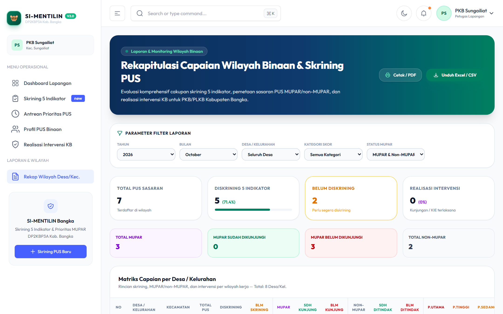

# Panduan Penggunaan SI-MENTILIN untuk Petugas Lapangan (PKB/PLKB)

Selamat datang di Buku Petunjuk Operasional **SI-MENTILIN** (*Sistem Skrining Lima Indikator PUS & Penanda Sasaran MUPAR*) untuk **Petugas Lapangan KB (PKB / PLKB / Koordinator Lapangan Kecamatan)** pada **Dinas Pengendalian Penduduk, Keluarga Berencana, Pemberdayaan Perempuan dan Perlindungan Anak (DP2KBP3A) Kabupaten Bangka**.

Buku panduan ini disusun sebagai pedoman praktis langkah demi langkah (SOP) bagi petugas dalam melakukan pendataan PUS, penapisan risiko kehamilan 5 indikator, penentuan sasaran MUPAR, tindak lanjut antrean prioritas, serta pencatatan realisasi intervensi KB.

> 📄 **Format Microsoft Word (.docx):** Dokumen ini juga tersedia dalam versi siap cetak bertata letak resmi: [**Unduh Panduan_Penggunaan_SI-MENTILIN_PKB.docx**](Panduan_Penggunaan_SI-MENTILIN_PKB.docx)

---

## Daftar Isi
1. [Prinsip Dasar & Logika Bisnis Sistem](#1-prinsip-dasar--logika-bisnis-sistem)
2. [Akses Masuk & Autentikasi Sistem](#2-akses-masuk--autentikasi-sistem)
3. [Eksplorasi Dashboard Kerja PKB](#3-eksplorasi-dashboard-kerja-pkb)
4. [Manajemen Data Profil PUS (Pasangan Usia Subur)](#4-manajemen-data-profil-pus-pasangan-usia-subur)
   - [Melihat dan Memfilter Data PUS](#melihat-dan-memfilter-data-pus)
   - [Menambah Data PUS Baru](#menambah-data-pus-baru)
5. [Skrining 5 Indikator & Deteksi MUPAR](#5-skrining-5-indikator--deteksi-mupar)
   - [Struktur 5 Parameter Skrining](#struktur-5-parameter-skrining)
   - [Proses Pengisian Formulir Skrining](#proses-pengisian-formulir-skrining)
   - [Hasil Kalkulasi & Ketetapan Prioritas](#hasil-kalkulasi--ketetapan-prioritas)
6. [Pengelolaan Antrean Prioritas (Priority Queue)](#6-pengelolaan-antrean-prioritas-priority-queue)
7. [Pencatatan Realisasi Intervensi & Konseling KB](#7-pencatatan-realisasi-intervensi--konseling-kb)
8. [Riwayat Skrining & Pemantauan Data](#8-riwayat-skrining--pemantauan-data)
9. [Modul Proyeksi Capaian MCPR, TFR & Nilai Ekonomis](#9-modul-proyeksi-capaian-mcpr-tfr--nilai-ekonomis)
10. [Pelaporan & Ekspor Data Tingkat Lapangan](#10-pelaporan--ekspor-data-tingkat-lapangan)
11. [Troubleshooting & Tanya Jawab (FAQ)](#11-troubleshooting--tanya-jawab-faq)

---

## 1. Prinsip Dasar & Logika Bisnis Sistem

Aplikasi SI-MENTILIN dirancang dengan standar logika bisnis terukur:
1. **Skoring 5 Indikator (0–15):**
   - **P1 (Usia Istri):** Terhitung otomatis dari tanggal lahir istri (Skor 0 s.d 3).
   - **P2 (Jumlah Anak Lahir Hidup):** Terhitung otomatis dari paritas PUS (Skor 0 s.d 3).
   - **P3 (Status Kontrasepsi):** Diisi berdasarkan status kepesertaan KB saat ini (Skor 0 s.d 3).
   - **P4 (Tujuan Reproduksi):** Kebutuhan menunda, menjarangkan, atau tidak ingin anak lagi (Skor 0 s.d 3).
   - **P5 (Risiko KTD):** Riwayat komplikasi, 4 Terlalu, atau penyakit penyerta (Skor 0 s.d 3).
   - **Total Skor:** `Total = P1 + P2 + P3 + P4 + P5` (Rentang: 0 s.d 15).
2. **Kategori Skor:**
   - **Rendah:** Total skor 0 – 6
   - **Sedang:** Total skor 7 – 10
   - **Tinggi:** Total skor 11 – 15
3. **MUPAR (Muda Paritas Rendah) BUKAN Penambah Skor:**
   - MUPAR adalah indikator penanda khusus (Istri usia $\le$ 35 tahun dengan anak lahir hidup $\le$ 2).
   - MUPAR bertindak sebagai *multiplier strategis* yang memprioritaskan antrean intervensi:
     - **Skor 11–15 + MUPAR** $\rightarrow$ **Prioritas Utama (#1)** (Wajib kunjungan segera)
     - **Skor 11–15 + Non-MUPAR** $\rightarrow$ **Prioritas Tinggi (#2)**
     - **Skor 7–10 + MUPAR** $\rightarrow$ **Prioritas Edukasi Terjadwal (#3)**
     - **Skor 7–10 + Non-MUPAR** $\rightarrow$ **Prioritas Sedang (#4)**
     - **Skor 0–6 (MUPAR / Non-MUPAR)** $\rightarrow$ **Monitoring / Edukasi Rutin (#5)**
4. **Isolasi Wilayah Petugas Lapangan:**
   - PKB hanya dapat melihat, menambah, dan mengelola data PUS di kecamatan atau desa tempat yang bersangkutan ditugaskan.

---

## 2. Akses Masuk & Autentikasi Sistem

Setiap petugas lapangan dibekali akun resmi dari DP2KBP3A Kabupaten Bangka.

### Langkah-langkah Masuk:
1. Buka peramban (*web browser*) seperti Google Chrome atau Microsoft Edge pada laptop atau smartphone.
2. Akses alamat web SI-MENTILIN yang telah ditetapkan oleh admin dinas.
3. Masukkan **Alamat Email** resmi Anda (contoh: `pkb.sungailiat@simentilin.bangka.go.id`).
4. Masukkan **Kata Sandi** akun Anda. Anda dapat mengklik ikon mata di sisi kanan untuk memeriksa ketepatan karakter sandi.
5. Centang opsi **Ingat sesi login saya** jika menggunakan perangkat pribadi.
6. Klik tombol **Masuk ke Sistem**. Sistem akan memverifikasi kredensial dan langsung mengarahkan Anda ke Dashboard Petugas Lapangan.

> **Catatan Keamanan:** Sistem dilengkapi pembatasan percobaan login (Rate Limiting). Hindari kesalahan pengetikan sandi lebih dari 5 kali berturut-turut agar akun tidak terkunci sementara selama 60 detik.

---

## 3. Eksplorasi Dashboard Kerja PKB

Setelah login berhasil, Anda disambut oleh **Dashboard Petugas Lapangan**. Dashboard ini menyajikan indikator kinerja utama secara *real-time* di wilayah binaan Anda.

### Komponen Utama Dashboard:
1. **Kartu Statistik Ringkas (Top KPI Cards):**
   - **Total PUS Terdata:** Akumulasi pasangan usia subur di desa/kelurahan binaan Anda.
   - **Skrining Selesai:** Jumlah PUS yang telah diskrining 5 indikator.
   - **Persentase Sasaran MUPAR:** Proporsi PUS muda beranak sedikit yang rentan tidak ber-KB.
   - **Realisasi Intervensi:** Jumlah tindakan advokasi, konseling, dan pemasangan alokon KB yang telah tercatat.
2. **Status Antrean Prioritas:**
   - Notifikasi jumlah PUS yang masuk dalam kategori **Prioritas Utama** dan **Prioritas Tinggi** yang membutuhkan penanganan segera.
3. **Grafik Sebaran & Progres:**
   - Visualisasi distribusi PUS per dusun/lingkungan serta tren capaian penapisan bulanan.

---

## 4. Manajemen Data Profil PUS (Pasangan Usia Subur)

Menu **Data PUS** merupakan basis data utama seluruh keluarga sasaran di wilayah kerja Anda.

### Melihat dan Memfilter Data PUS

Akses menu **Data PUS** pada bilah navigasi kiri.

Fitur pada halaman ini meliputi:
- **Pencarian Cepat:** Ketik nama istri, nama suami, atau alamat untuk menemukan data secara instan.
- **Filter Status Skrining:** Saring berdasarkan PUS yang *Sudah Skrining* atau *Belum Skrining*.
- **Filter Status MUPAR:** Tampilkan khusus PUS berstatus MUPAR atau Non-MUPAR.
- **Badge Indikator Status:** Setiap baris dilengkapi badge otomatis status usia, jumlah anak, dan MUPAR.

### Menambah Data PUS Baru

Jika ada pasangan usia subur baru di lingkungan kerja Anda:
1. Klik tombol **Tambah Profil PUS** (tombol hijau di pojok kanan atas).
2. Jendela pop-up (modal) formulir akan muncul.

3. Lengkapi isian data berikut:
   - **Nama Istri:** Nama lengkap istri (contoh: *Ny. Siti Rahma*).
   - **Nama Suami:** Nama lengkap suami (contoh: *Tn. Ahmad Zaki*).
   - **Tanggal Lahir Istri:** Pilih tanggal lahir pada kalender (sistem akan otomatis menghitung umur istri).
   - **Jumlah Anak Lahir Hidup:** Masukkan angka paritas anak yang dilahirkan hidup (contoh: *1*).
   - **Kecamatan & Desa:** Terisi otomatis sesuai wilayah penugasan Anda.
   - **RT / RW:** Masukkan identitas RT dan RW domisili.
   - **Alamat Lengkap:** Masukkan nama jalan, dusun, atau patokan rumah.
4. Klik tombol **Simpan Profil PUS**. Data baru akan langsung tercatat dan siap untuk diskrining.

---

## 5. Skrining 5 Indikator & Deteksi MUPAR

Modul Skrining adalah jantung dari inovasi aplikasi SI-MENTILIN. Petugas tidak perlu lagi menghitung skor manual atau menebak kategori intervensi.

### Struktur 5 Parameter Skrining

| Parameter | Nama Indikator | Sumber Data | Rentang Skor |
| :--- | :--- | :--- | :---: |
| **P1** | Usia Istri | Otomatis dari Tanggal Lahir | 0 – 3 |
| **P2** | Paritas (Jumlah Anak Hidup) | Otomatis dari Data PUS | 0 – 3 |
| **P3** | Status Pemakaian Kontrasepsi | Inputan PKB saat skrining | 0 – 3 |
| **P4** | Kebutuhan / Rencana Reproduksi | Inputan PKB saat skrining | 0 – 3 |
| **P5** | Risiko Kehamilan Tidak Direncanakan (KTD) | Inputan PKB saat skrining | 0 – 3 |

> **Perhatian:** MUPAR (*Istri $\le$ 35 th dan Anak Hidup $\le$ 2*) berstatus **Flag Boolean (Ya / Tidak)** dan **TIDAK PERNAH MENAMBAH ANGKA SKOR**.

### Proses Pengisian Formulir Skrining

Akses menu **Kalkulator Skrining** atau klik tombol **Skrining** pada baris data PUS.

1. **Pilih Sasaran PUS:**
   - Cari dan pilih nama PUS yang akan diskrining.
   - Seketika PUS dipilih, sistem otomatis menampilkan usia istri, jumlah anak, menghitung nilai **P1**, nilai **P2**, dan menyalakan badge status **MUPAR**.
2. **Pilih Kondisi P3 (Status Kontrasepsi):**
   - *Skor 0:* Sedang menggunakan MKJP (IUD, Implan, MOW, MOP) dengan kondisi baik.
   - *Skor 1:* Sedang menggunakan Non-MKJP (Suntik, Pil, Kondom) secara teratur.
   - *Skor 2:* Pernah ber-KB namun putus pakai (*drop out*).
   - *Skor 3:* Belum pernah ber-KB sama sekali.
3. **Pilih Kondisi P4 (Tujuan Reproduksi):**
   - *Skor 0:* Ingin anak segera / hamil terencana.
   - *Skor 1:* Ingin anak nanti / menunda > 2 tahun.
   - *Skor 2:* Tidak ingin anak lagi / sudah cukup.
   - *Skor 3:* Ragu-ragu / ada penolakan suami atau keluarga.
4. **Pilih Kondisi P5 (Risiko KTD):**
   - *Skor 0:* Tidak ada faktor risiko / kondisi kesehatan prima.
   - *Skor 1:* Jarak kehamilan terakhir < 2 tahun.
   - *Skor 2:* Ada riwayat komplikasi persalinan sebelumnya.
   - *Skor 3:* Memiliki riwayat penyakit kronis (hipertensi, anemia, KEK) atau ancaman 4 Terlalu.
5. **Tambahkan Catatan Khusus:** Tuliskan keluhan atau preferensi akseptor (misalnya: *Istri ingin pasang implan tapi takut jarum suntik*).

### Hasil Kalkulasi & Ketetapan Prioritas

Saat Anda memilih opsi radio, panel di sebelah kanan akan menghitung skor seketika tanpa perlu memuat ulang halaman (*real-time Livewire reactivity*).

Sistem menampilkan:
- **Total Skor:** (Contoh: `12 / 15` $\rightarrow$ Kategori **Tinggi**).
- **Deteksi MUPAR:** Label hijau cerah aktif `MUPAR Terdeteksi`.
- **Ketetapan Prioritas Akhir:** Ditampilkan dalam badge merah menyala: **PRIORITAS UTAMA**.
- **Instruksi Tindakan:** Rekomendasi tindakan lapangan yang terstandarisasi bagi petugas (contoh: *Lakukan penjangkauan rumah dan konseling intensif dalam 1x24 jam*).
- Klik tombol **Simpan Hasil Skrining** untuk membukukan data.

---

## 6. Pengelolaan Antrean Prioritas (Priority Queue)

Data yang telah diskrining secara otomatis masuk ke dalam modul **Antrean Prioritas Skrining**. Modul ini memandu PKB menentukan urutan kunjungan rumah harian atau mingguan.

### Urutan Hirarki Antrean:
1. **Urutan #1 (Prioritas Utama):** Skor 11–15 + Status MUPAR (Lencana Merah Pekat). Pasangan muda beranak sedikit yang berada pada risiko kehamilan tinggi tanpa proteksi KB modern.
2. **Urutan #2 (Prioritas Tinggi):** Skor 11–15 + Non-MUPAR (Lencana Merah Sedang).
3. **Urutan #3 (Prioritas Edukasi Terjadwal):** Skor 7–10 + Status MUPAR (Lencana Ungu).
4. **Urutan #4 (Prioritas Sedang):** Skor 7–10 + Non-MUPAR (Lencana Kuning / Amber).
5. **Urutan #5 (Monitoring Rutin):** Skor 0–6 (Lencana Hijau).

### Tindakan pada Antrean:
- **Tombol Rincian:** Membuka lembar skor detail masing-masing indikator P1–P5.
- **Tombol Intervensi:** Membuka formulir pencatatan intervensi langsung dari baris antrean tanpa berpindah halaman.

---

## 7. Pencatatan Realisasi Intervensi & Konseling KB

Setelah petugas melakukan advokasi, konseling KIE, atau fasilitasi ke faskes, catatan hasil intervensi wajib dimasukkan ke dalam sistem.

### Langkah Pengisian Formulir Intervensi:
1. Klik tombol **Intervensi** pada daftar Antrean Prioritas.
2. Lengkapi formulir modal:
   - **Tanggal Intervensi:** Tanggal pelaksanaan kunjungan atau konseling.
   - **Jenis Pelayanan / KIE:** Pilih jenis intervensi (Konseling KIE Individu, Rujukan Faskes, Pelayanan Statis/Bergerak, Kunjungan Rumah).
   - **Metode KB yang Disepakati:**
     - *Modern MKJP:* IUD, Implan, MOW, MOP.
     - *Modern Non-MKJP:* Suntik 1/3 Bulan, Pil KB, Kondom.
     - *Belum Ber-KB:* Jika masih dalam tahap pertimbangan.
   - **Hasil & Kesepakatan Konseling:** Catat tanggapan calon akseptor dan suami.
   - **Rencana Tindak Lanjut / Jadwal Kunjungan Ulang:** Tentukan tanggal kunjungan berikutnya untuk evaluasi efek samping atau jadwal pasang.
3. Klik **Simpan Realisasi Intervensi**.

Daftar seluruh rekam intervensi dapat dipantau pada menu **Realisasi Intervensi KB**.

---

## 8. Riwayat Skrining & Pemantauan Data

Menu **Riwayat Skrining** menyimpan seluruh jejak audit penapisan yang pernah dilakukan oleh petugas lapangan.

Pada halaman ini petugas dapat:
- Melihat tanggal penapisan terakhir setiap PUS.
- Memeriksa skor breakdown (P1, P2, P3, P4, P5).
- Memantau apakah PUS tersebut sudah memiliki catatan intervensi tindak lanjut atau belum.

---

## 9. Modul Proyeksi Capaian MCPR, TFR & Nilai Ekonomis

Aplikasi SI-MENTILIN dilengkapi modul analitik makro untuk mengukur kontribusi kerja lapangan petugas terhadap target pembangunan keluarga berencana.

Petugas dapat mempelajari:
- **Tingkat Prevalensi Kontrasepsi Modern (MCPR):** Capaian penggunaan alokon modern di wilayah kerja.
- **Proyeksi Penurunan TFR (Total Fertility Rate):** Dampak penapisan PUS MUPAR terhadap angka kelahiran total.
- **Nilai Ekonomis Penyelamatan (Cost Savings):** Estimasi penghematan beban pembiayaan medis obstetri dan risiko stunting yang berhasil dicegah berkat intervensi dini petugas.

---

## 10. Pelaporan & Ekspor Data Tingkat Lapangan

Modul **Laporan** mempermudah petugas dalam menyusun laporan bulanan kinerja lapangan ke Koordinator Kecamatan maupun Dinas.

### Cara Mengunduh Laporan:
1. Akses menu **Laporan**.
2. Tentukan filter rentang tanggal (contoh: *01/10/2026 s.d 31/10/2026*).
3. Pilih jenis laporan yang dibutuhkan:
   - *Rekapitulasi Skrining 5 Indikator*
   - *Daftar Sasaran PUS MUPAR Risiko Tinggi*
   - *Realisasi Pelayanan Intervensi KB*
4. Klik tombol **Ekspor PDF** untuk dokumen cetak bertandatangan, atau **Ekspor Excel (CSV)** untuk pengolahan spreadsheet mandiri.

---

## 11. Troubleshooting & Tanya Jawab (FAQ)

### Q1: Mengapa nama istri yang saya cari tidak muncul saat ingin melakukan skrining?
> **Jawaban:** Pastikan data profil PUS tersebut sudah diinput terlebih dahulu pada menu **Data PUS**. Hanya data PUS yang terdaftar di desa binaan Anda yang akan muncul pada pencarian.

### Q2: Mengapa PUS dengan skor 9 bisa berada di antrean lebih atas dibanding PUS dengan skor 10?
> **Jawaban:** Periksa status **MUPAR**. Berdasarkan logika bisnis SI-MENTILIN, PUS dengan skor 7–10 yang berstatus MUPAR (Prioritas Edukasi Terjadwal #3) memiliki bobot urgensi penanganan yang lebih diutamakan dibandingkan PUS non-MUPAR pada rentang skor yang sama.

### Q3: Apakah saya bisa mengubah hasil skrining jika salah memilih opsi?
> **Jawaban:** Anda dapat melakukan skrining ulang kapan saja. Sistem akan mencatat riwayat penapisan terbaru sebagai acuan antrean terkini.

### Q4: Apa yang harus dilakukan jika lupa kata sandi akun?
> **Jawaban:** Hubungi Administrator Dinas di DP2KBP3A Kabupaten Bangka untuk melakukan reset kata sandi melalui Modul Manajemen Pengguna.
