# 🚀 Panduan Deploy SI-MENTILIN ke Server Production

> Panduan lengkap untuk men-deploy aplikasi **SI-MENTILIN** (Laravel 13 + Livewire 4 + Vite 8 + Tailwind CSS 4) ke server production berbasis Ubuntu/Debian.

---

## Daftar Isi

1. [Persyaratan Server](#1-persyaratan-server)
2. [Persiapan Server](#2-persiapan-server)
3. [Konfigurasi Nginx](#3-konfigurasi-nginx)
4. [Deploy Aplikasi](#4-deploy-aplikasi)
5. [Konfigurasi Environment](#5-konfigurasi-environment)
6. [Build & Optimisasi](#6-build--optimisasi)
7. [SSL / HTTPS](#7-ssl--https)
8. [Queue Worker & Scheduler](#8-queue-worker--scheduler)
9. [Monitoring & Logging](#9-monitoring--logging)
10. [Rollback & Maintenance](#10-rollback--maintenance)
11. [Checklist Deploy](#11-checklist-deploy)

---

## 1. Persyaratan Server

### Minimum Hardware

| Komponen | Minimum | Rekomendasi |
|----------|---------|-------------|
| CPU | 2 vCPU | 4 vCPU |
| RAM | 2 GB | 4 GB |
| Disk | 20 GB SSD | 40 GB SSD |
| Bandwidth | 1 TB/bulan | Unlimited |

### Software Stack

| Software | Versi Minimum | Keterangan |
|----------|--------------|------------|
| **PHP** | 8.3+ | Wajib sesuai `composer.json` |
| **Nginx** | 1.24+ | Reverse proxy & static files |
| **MySQL** / **PostgreSQL** | 8.0+ / 16+ | Database production (ganti SQLite) |
| **Node.js** | 20 LTS+ | Build assets Vite |
| **Composer** | 2.7+ | PHP dependency manager |
| **Git** | 2.40+ | Version control |
| **Supervisor** | 4.x | Manage queue worker |
| **Certbot** | Latest | SSL Let's Encrypt |

### Ekstensi PHP Wajib

```bash
php -m | grep -E "bcmath|ctype|curl|dom|fileinfo|json|mbstring|openssl|pdo|pdo_mysql|tokenizer|xml|zip|intl|redis"
```

```
bcmath, ctype, curl, dom, fileinfo, json, mbstring, openssl,
pdo, pdo_mysql, tokenizer, xml, zip, intl, redis (opsional)
```

---

## 2. Persiapan Server

### 2.1 Update Sistem & Install Dependencies

```bash
sudo apt update && sudo apt upgrade -y

# Install PHP 8.3 + Ekstensi
sudo add-apt-repository ppa:ondrej/php -y
sudo apt install -y php8.3-fpm php8.3-cli php8.3-common \
    php8.3-mysql php8.3-pgsql php8.3-zip php8.3-gd \
    php8.3-mbstring php8.3-curl php8.3-xml php8.3-bcmath \
    php8.3-intl php8.3-readline php8.3-redis php8.3-opcache

# Install Nginx, MySQL, Supervisor, Git
sudo apt install -y nginx mysql-server supervisor git unzip
```

### 2.2 Install Composer

```bash
curl -sS https://getcomposer.org/installer | php
sudo mv composer.phar /usr/local/bin/composer
composer --version
```

### 2.3 Install Node.js (via nvm)

```bash
curl -o- https://raw.githubusercontent.com/nvm-sh/nvm/v0.40.0/install.sh | bash
source ~/.bashrc
nvm install --lts
node -v && npm -v
```

### 2.4 Buat User Deploy (Non-Root)

```bash
sudo adduser deploy
sudo usermod -aG www-data deploy
sudo chown -R deploy:www-data /var/www
```

> [!WARNING]
> **Jangan pernah jalankan aplikasi sebagai root.** Selalu gunakan user `deploy` atau user non-root lainnya.

---

## 3. Konfigurasi Nginx

### 3.1 Buat Server Block

```bash
sudo nano /etc/nginx/sites-available/simentilin
```

```nginx
server {
    listen 80;
    listen [::]:80;
    server_name simentilin.bangka.go.id;  # Ganti dengan domain Anda
    root /var/www/simentilin/public;

    index index.php index.html;

    charset utf-8;

    # Gzip Compression
    gzip on;
    gzip_comp_level 5;
    gzip_min_length 256;
    gzip_proxied any;
    gzip_vary on;
    gzip_types
        application/javascript
        application/json
        application/xml
        text/css
        text/plain
        text/javascript
        image/svg+xml;

    # Security Headers
    add_header X-Frame-Options "SAMEORIGIN" always;
    add_header X-Content-Type-Options "nosniff" always;
    add_header X-XSS-Protection "1; mode=block" always;
    add_header Referrer-Policy "strict-origin-when-cross-origin" always;

    # Max Upload (sesuaikan)
    client_max_body_size 10M;

    location / {
        try_files $uri $uri/ /index.php?$query_string;
    }

    # Vite Build Assets — Cache Panjang (immutable)
    location /build/ {
        expires max;
        add_header Cache-Control "public, immutable";
        try_files $uri =404;
    }

    # Static Assets
    location ~* \.(jpg|jpeg|png|gif|ico|svg|webp|woff2?|ttf|eot|css|js)$ {
        expires 30d;
        add_header Cache-Control "public, no-transform";
        access_log off;
    }

    location = /favicon.ico { access_log off; log_not_found off; }
    location = /robots.txt  { access_log off; log_not_found off; }

    error_page 404 /index.php;

    location ~ \.php$ {
        fastcgi_pass unix:/var/run/php/php8.3-fpm.sock;
        fastcgi_param SCRIPT_FILENAME $realpath_root$fastcgi_script_name;
        include fastcgi_params;

        # Timeouts untuk Livewire long-polling
        fastcgi_read_timeout 300;
        fastcgi_send_timeout 300;
    }

    # Blokir akses ke file sensitif
    location ~ /\.(?!well-known).* {
        deny all;
    }
}
```

### 3.2 Aktifkan Site

```bash
sudo ln -s /etc/nginx/sites-available/simentilin /etc/nginx/sites-enabled/
sudo rm /etc/nginx/sites-enabled/default   # Hapus default (opsional)
sudo nginx -t                               # Test konfigurasi
sudo systemctl reload nginx
```

---

## 4. Deploy Aplikasi

### 4.1 Clone Repository

```bash
sudo -u deploy -i
cd /var/www
git clone git@github.com:hoirulr/simentilin.git
cd simentilin
```

### 4.2 Set Permission

```bash
# Ownership
sudo chown -R deploy:www-data /var/www/simentilin

# Directory permission
find /var/www/simentilin -type d -exec chmod 755 {} \;

# File permission
find /var/www/simentilin -type f -exec chmod 644 {} \;

# Storage & Cache — writable oleh web server
sudo chmod -R 775 storage bootstrap/cache
sudo chown -R deploy:www-data storage bootstrap/cache
```

> [!IMPORTANT]
> Pastikan direktori `storage/` dan `bootstrap/cache/` writable oleh user `www-data` (PHP-FPM).

### 4.3 Install Dependencies

```bash
# PHP Dependencies (tanpa dev)
composer install --no-dev --optimize-autoloader --no-interaction

# Node Dependencies & Build
npm ci
npm run build
```

> [!TIP]
> Gunakan `npm ci` bukan `npm install` di production. `npm ci` lebih cepat dan memastikan versi yang cocok persis dengan `package-lock.json`.

---

## 5. Konfigurasi Environment

### 5.1 Buat File `.env`

```bash
cp .env.example .env
nano .env
```

### 5.2 Nilai Wajib untuk Production

```dotenv
# ── Aplikasi ──────────────────────────────────────────────
APP_NAME="SI-MENTILIN"
APP_ENV=production
APP_KEY=                          # Generate di langkah berikutnya
APP_DEBUG=false                   # ⚠️ WAJIB false di production!
APP_URL=https://simentilin.bangka.go.id

APP_LOCALE=id
APP_FALLBACK_LOCALE=id
APP_FAKER_LOCALE=id_ID

APP_MAINTENANCE_DRIVER=file

# ── Database (MySQL) ─────────────────────────────────────
DB_CONNECTION=mysql
DB_HOST=127.0.0.1
DB_PORT=3306
DB_DATABASE=simentilin_prod
DB_USERNAME=simentilin_user
DB_PASSWORD=<PASSWORD_KUAT_ACAK>

# ── Session & Cache ──────────────────────────────────────
SESSION_DRIVER=database
SESSION_LIFETIME=120
SESSION_ENCRYPT=true              # Enkripsi session di production
SESSION_SECURE_COOKIE=true        # Cookie hanya via HTTPS
SESSION_DOMAIN=simentilin.bangka.go.id

CACHE_STORE=database              # Atau redis jika tersedia
QUEUE_CONNECTION=database         # Atau redis

# ── Logging ──────────────────────────────────────────────
LOG_CHANNEL=stack
LOG_STACK=daily                   # Rotasi log harian
LOG_LEVEL=error                   # Hanya error & critical

# ── Mail (Produksi) ──────────────────────────────────────
MAIL_MAILER=smtp
MAIL_HOST=smtp.example.com
MAIL_PORT=587
MAIL_USERNAME=noreply@bangka.go.id
MAIL_PASSWORD=<SMTP_PASSWORD>
MAIL_ENCRYPTION=tls
MAIL_FROM_ADDRESS=noreply@bangka.go.id
MAIL_FROM_NAME="${APP_NAME}"

# ── Bcrypt ───────────────────────────────────────────────
BCRYPT_ROUNDS=12

VITE_APP_NAME="${APP_NAME}"
```

> [!CAUTION]
> - **`APP_DEBUG=false`** — Wajib! Jika `true`, stack trace & env terekspos ke publik.
> - **`APP_KEY`** — Jangan pernah share atau commit. Generate dengan `php artisan key:generate`.
> - **`DB_PASSWORD`** — Gunakan password acak minimal 24 karakter.

### 5.3 Generate App Key & Migrasi Database

```bash
php artisan key:generate

# Buat database MySQL terlebih dahulu
mysql -u root -p -e "CREATE DATABASE simentilin_prod CHARACTER SET utf8mb4 COLLATE utf8mb4_unicode_ci;"
mysql -u root -p -e "CREATE USER 'simentilin_user'@'localhost' IDENTIFIED BY '<PASSWORD>';"
mysql -u root -p -e "GRANT ALL PRIVILEGES ON simentilin_prod.* TO 'simentilin_user'@'localhost';"
mysql -u root -p -e "FLUSH PRIVILEGES;"

# Jalankan migrasi
php artisan migrate --force

# Jalankan seeder (jika diperlukan untuk data awal)
php artisan db:seed --force
```

### 5.4 Symlink Storage

```bash
php artisan storage:link
```

---

## 6. Build & Optimisasi

### 6.1 Cache Konfigurasi (Wajib di Production)

```bash
# Cache semua config, routes, views, dan events
php artisan optimize

# Atau satu-persatu:
# php artisan config:cache
# php artisan route:cache
# php artisan view:cache
# php artisan event:cache
```

> [!NOTE]
> Perintah `php artisan optimize` sudah menjalankan semua cache di atas sekaligus. Jalankan ulang setiap kali deploy kode baru.

### 6.2 PHP OPcache (Konfigurasi)

Edit `/etc/php/8.3/fpm/conf.d/10-opcache.ini`:

```ini
opcache.enable=1
opcache.memory_consumption=256
opcache.interned_strings_buffer=64
opcache.max_accelerated_files=20000
opcache.revalidate_freq=0          ; 0 = cek hanya saat restart (ideal production)
opcache.validate_timestamps=0      ; Matikan di production
opcache.save_comments=1
opcache.jit=on
opcache.jit_buffer_size=128M
```

```bash
sudo systemctl restart php8.3-fpm
```

### 6.3 PHP-FPM Tuning

Edit `/etc/php/8.3/fpm/pool.d/www.conf`:

```ini
; Untuk server 4 GB RAM
pm = dynamic
pm.max_children = 50
pm.start_servers = 10
pm.min_spare_servers = 5
pm.max_spare_servers = 20
pm.max_requests = 1000

; Logging
php_admin_flag[log_errors] = on
php_admin_value[error_log] = /var/log/php-fpm/error.log
```

---

## 7. SSL / HTTPS

### 7.1 Install Certbot & Generate SSL

```bash
sudo apt install -y certbot python3-certbot-nginx

sudo certbot --nginx -d simentilin.bangka.go.id \
    --non-interactive \
    --agree-tos \
    --email admin@bangka.go.id
```

### 7.2 Auto-Renew

Certbot otomatis menambahkan cron/timer. Verifikasi:

```bash
sudo certbot renew --dry-run
```

### 7.3 Redirect HTTP → HTTPS

Certbot biasanya otomatis menambahkan redirect. Jika belum, tambahkan di Nginx:

```nginx
server {
    listen 80;
    server_name simentilin.bangka.go.id;
    return 301 https://$server_name$request_uri;
}
```

---

## 8. Queue Worker & Scheduler

### 8.1 Supervisor untuk Queue Worker

Buat file `/etc/supervisor/conf.d/simentilin-worker.conf`:

```ini
[program:simentilin-worker]
process_name=%(program_name)s_%(process_num)02d
command=php /var/www/simentilin/artisan queue:work database --sleep=3 --tries=3 --max-time=3600
autostart=true
autorestart=true
stopasgroup=true
killasgroup=true
user=deploy
numprocs=2
redirect_stderr=true
stdout_logfile=/var/www/simentilin/storage/logs/worker.log
stopwaitsecs=3600
```

```bash
sudo supervisorctl reread
sudo supervisorctl update
sudo supervisorctl start simentilin-worker:*
```

### 8.2 Cron Scheduler

```bash
sudo crontab -u deploy -e
```

Tambahkan:

```
* * * * * cd /var/www/simentilin && php artisan schedule:run >> /dev/null 2>&1
```

---

## 9. Monitoring & Logging

### 9.1 Log Harian (Sudah Dikonfigurasi)

```bash
# Lihat log terbaru
tail -f /var/www/simentilin/storage/logs/laravel-$(date +%Y-%m-%d).log

# Bersihkan log lama (> 14 hari)
find /var/www/simentilin/storage/logs -name "*.log" -mtime +14 -delete
```

### 9.2 Health Check Endpoint (Opsional)

Tambahkan endpoint health check di `routes/web.php`:

```php
Route::get('/health', function () {
    try {
        DB::connection()->getPdo();
        return response()->json([
            'status' => 'ok',
            'timestamp' => now()->toIso8601String(),
        ]);
    } catch (\Exception $e) {
        return response()->json([
            'status' => 'error',
            'message' => 'Database unavailable',
        ], 503);
    }
})->name('health-check');
```

### 9.3 Monitoring Disk & Memory

```bash
# Cron: alert jika disk > 85%
echo '0 */6 * * * df -h / | awk "NR==2 && int(\$5) > 85 {print \"DISK WARNING: \" \$5}" | mail -s "SI-MENTILIN Disk Alert" admin@bangka.go.id' | sudo crontab -u root -
```

---

## 10. Rollback & Maintenance

### 10.1 Maintenance Mode

```bash
# Aktifkan maintenance mode (tampilkan halaman 503)
php artisan down --secret="bypass-token-rahasia"

# Bypass maintenance via URL:
# https://simentilin.bangka.go.id/bypass-token-rahasia

# Nonaktifkan maintenance mode
php artisan up
```

### 10.2 Script Deploy Ulang (Update Kode)

Buat file `deploy.sh` di server:

```bash
#!/bin/bash
set -e

APP_DIR="/var/www/simentilin"
cd $APP_DIR

echo "🔧 Mengaktifkan maintenance mode..."
php artisan down --secret="bypass-$(date +%s)"

echo "📥 Pull kode terbaru..."
git pull origin main

echo "📦 Install dependencies..."
composer install --no-dev --optimize-autoloader --no-interaction
npm ci
npm run build

echo "🗄️  Migrasi database..."
php artisan migrate --force

echo "⚡ Optimisasi cache..."
php artisan optimize

echo "🔄 Restart services..."
sudo supervisorctl restart simentilin-worker:*
sudo systemctl reload php8.3-fpm

echo "✅ Nonaktifkan maintenance mode..."
php artisan up

echo "🎉 Deploy selesai! $(date)"
```

```bash
chmod +x deploy.sh
./deploy.sh
```

### 10.3 Rollback ke Versi Sebelumnya

```bash
# Lihat commit history
git log --oneline -10

# Rollback ke commit tertentu
php artisan down
git checkout <commit-hash>
composer install --no-dev --optimize-autoloader
npm ci && npm run build
php artisan migrate:rollback --step=1   # Jika ada migrasi baru
php artisan optimize
php artisan up
```

> [!WARNING]
> Rollback migrasi (`migrate:rollback`) hanya aman jika method `down()` pada migrasi sudah diimplementasikan dengan benar. Selalu test rollback di staging terlebih dahulu.

---

## 11. Checklist Deploy

Gunakan checklist berikut sebelum dan sesudah deploy:

### ✅ Pra-Deploy

- [ ] Semua test lulus (`composer test` atau `php artisan test`)
- [ ] `APP_DEBUG=false` di `.env`
- [ ] `APP_ENV=production` di `.env`
- [ ] Database production sudah dibuat dan accessible
- [ ] Password database menggunakan string acak yang kuat
- [ ] SSL/HTTPS sudah aktif
- [ ] Backup database terbaru sudah dibuat
- [ ] `.env` tidak ter-commit ke Git

### ✅ Pasca-Deploy

- [ ] `php artisan optimize` sudah dijalankan
- [ ] `npm run build` berhasil tanpa error
- [ ] `php artisan migrate --force` berhasil
- [ ] `php artisan storage:link` sudah dijalankan
- [ ] Queue worker aktif via Supervisor
- [ ] Cron scheduler sudah terdaftar
- [ ] Halaman login bisa diakses via HTTPS
- [ ] Skoring 5 indikator berfungsi (total 0–15)
- [ ] Role `petugas_lapangan` & `admin_dinas` berfungsi dengan filter kecamatan
- [ ] Dashboard grafik (MCPR, TFR, Nilai Ekonomis) ter-render dengan benar
- [ ] Log error tidak ada di `storage/logs/`

---

## Arsitektur Deployment

```mermaid
graph TB
    subgraph Internet
        U["👤 Browser User"]
    end

    subgraph Server["🖥️ Server Production (Ubuntu)"]
        NG["Nginx<br/>:443 HTTPS"]
        PHP["PHP 8.3 FPM"]
        LW["Laravel 13<br/>+ Livewire 4"]
        DB[("MySQL 8.0<br/>simentilin_prod")]
        SV["Supervisor<br/>Queue Worker"]
        CR["Cron<br/>Scheduler"]
        ST["Storage<br/>/storage/app"]
    end

    U -->|HTTPS| NG
    NG -->|FastCGI| PHP
    PHP --> LW
    LW --> DB
    LW --> ST
    SV -->|queue:work| LW
    CR -->|schedule:run| LW

    style NG fill:#22c55e,color:#fff
    style PHP fill:#6366f1,color:#fff
    style LW fill:#ef4444,color:#fff
    style DB fill:#3b82f6,color:#fff
```



---

> [!TIP]
> **Rekomendasi tambahan untuk production:**
> - Gunakan **Redis** sebagai cache & queue driver untuk performa lebih baik dibanding `database`.
> - Pertimbangkan **Laravel Forge** atau **Ploi** untuk automated server management.
> - Setup **daily database backup** dengan `mysqldump` + upload ke cloud storage (S3/GCS).
> - Gunakan **Laravel Telescope** (hanya untuk debugging, nonaktifkan di production) atau **Sentry** untuk error tracking.
